# Comic Shooter

Top-down Comic-Shooter für Desktop und Android. Vier Welten, Wellen-Modus mit
Bossen, Koop über LAN und ein Kosmetik-Shop mit Edelsteinen und Lootboxen.

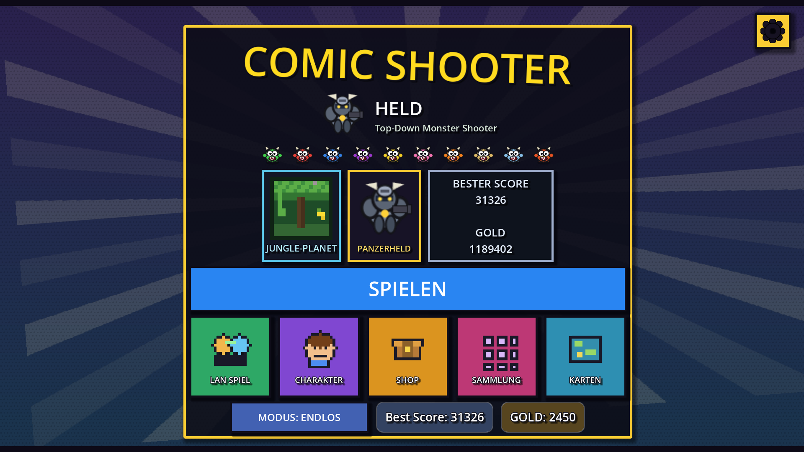

## Die vier Welten

Jede Welt hat eine eigene prozedural generierte Karte, eigene Gegner und
einen eigenen Boss.

| Erde | Mars |
|---|---|
| 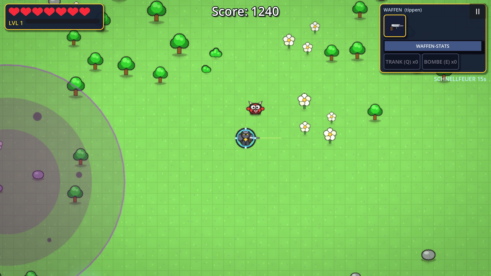 | 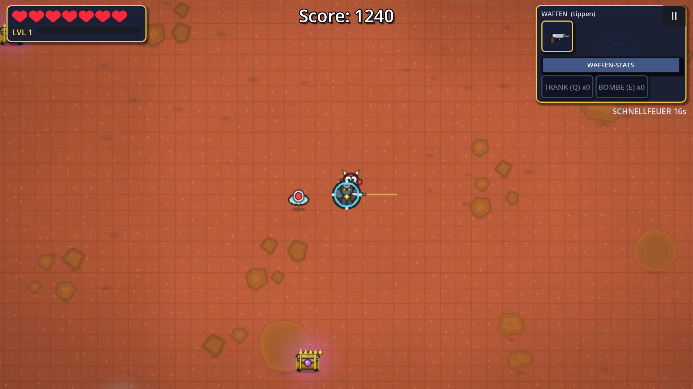 |

| Dschungel | Elektro |
|---|---|
| 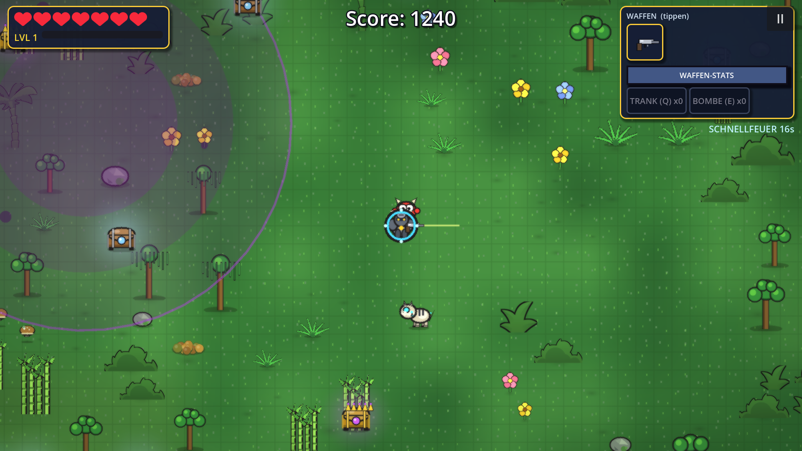 | 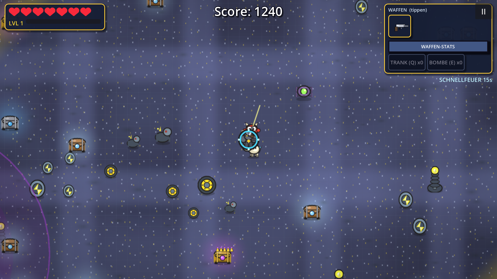 |

## Bosse

Alle 10 Wellen erscheint der Biome-Boss, dazwischen alle 5 Wellen ein Mini-Boss.
Jeder Boss hat eigene Angriffsmuster und eine eigene Schwachstelle.

| Splitter-König (Erde) | Meteor-Golem (Mars) |
|---|---|
| 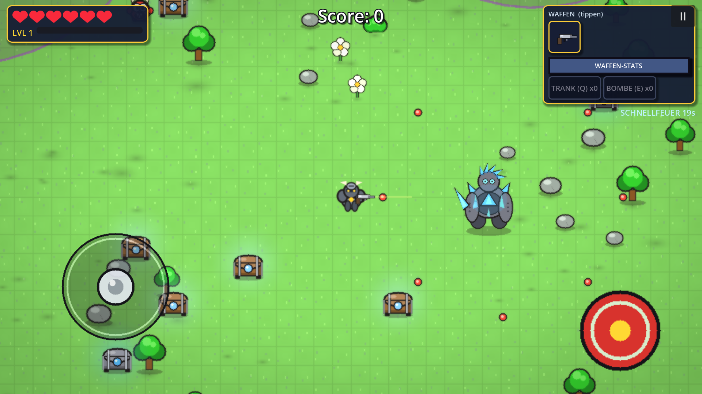 | 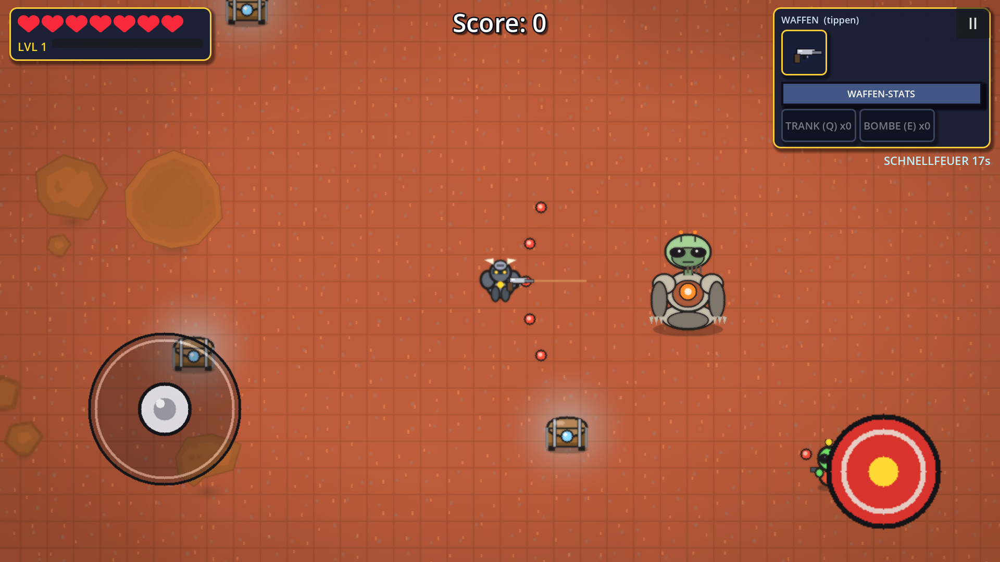 |

| Robo-Affe-König (Dschungel) | Volt-Boss (Elektro) |
|---|---|
| 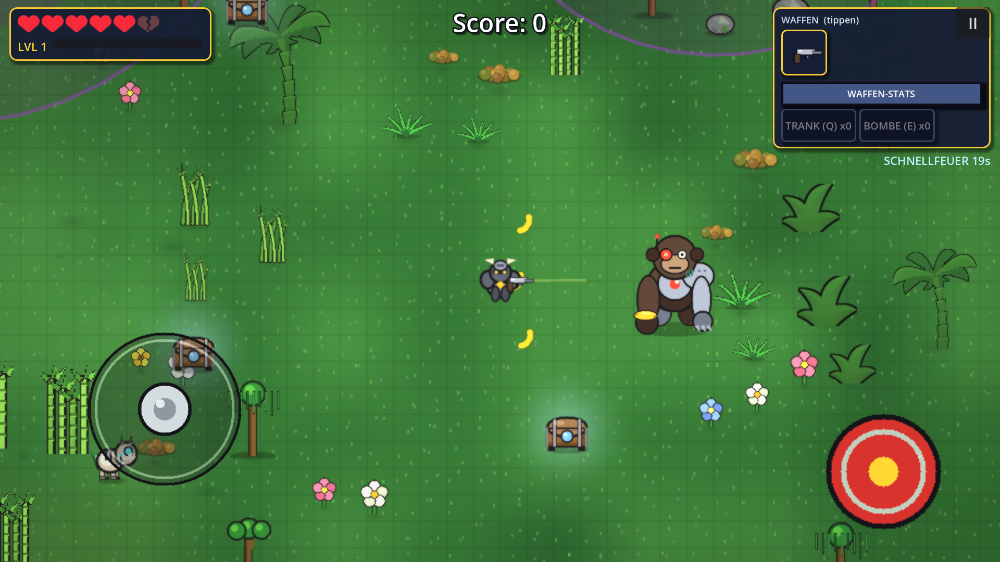 | 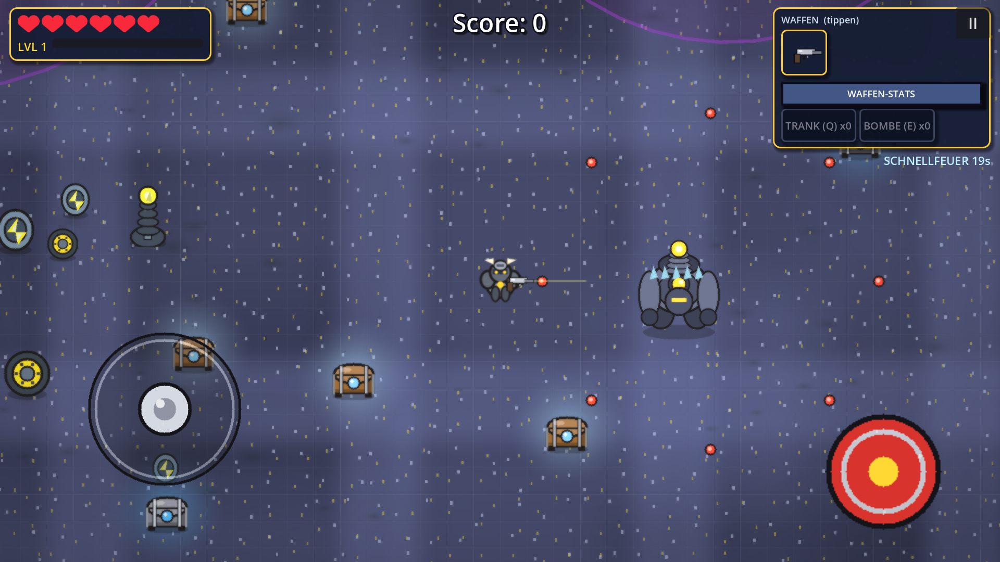 |

## Charaktere

Sechs Skins, zehn Hüte und mehrere Farben — alles nur kosmetisch, die
Spielbalance bleibt unberührt.

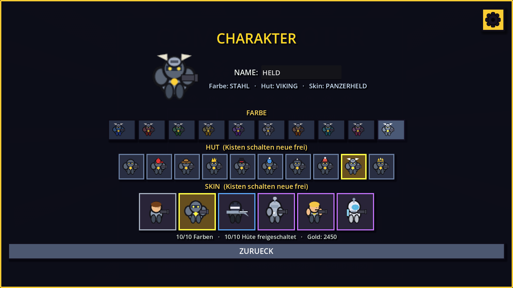

## Shop und Lootboxen

Kisten kosten 12, 18 oder 28 Edelsteine. Edelsteine kauft man mit Gold —
1.000 Gold = 1 💎, 10.000 Gold = 12 💎.


Beim Öffnen läuft ein Streifen durch, bleibt auf dem Gewinn stehen und die
Kachel leuchtet auf — gestaffelt nach Seltenheit.

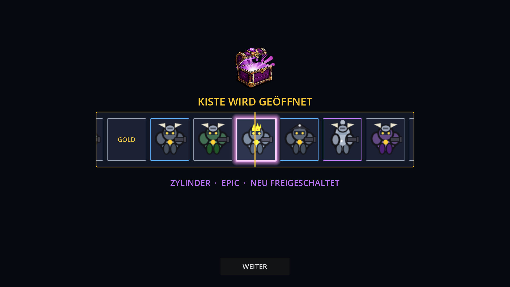

Rund 35–40 % der Kisten bringen keinen Skin: Niete, Gold oder Edelsteine als
Trostpreis (gemessen über 8.000 Züge je Kiste).

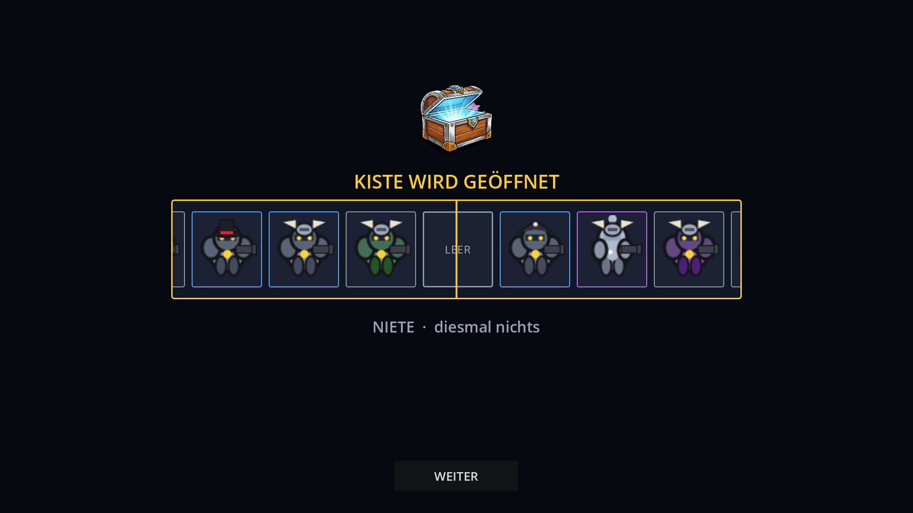

| Kiste | Preis | Inhalt |
|---|---|---|
| Standard | 12 💎 | Farben, Hüte |
| Silber | 18 💎 | bessere Chancen, keine Skins |
| Premium | 28 💎 | zusätzlich Skins, nie gewöhnlich |

## Einstellungen

Musik und Soundeffekte getrennt schaltbar, Grafikqualität, Aim-Assist,
Schwierigkeit — alles im Comic-Stil der Startseite.

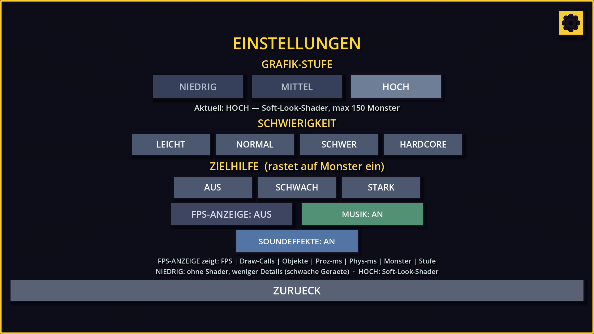

## Steuerung

| Taste | Aktion |
|---|---|
| WASD / Pfeile | Bewegen |
| Maus | Zielen |
| Linke Maustaste | Schießen (halten = Dauerfeuer) |
| Q / E | Trank / Bombe |
| ESC | Pause |
| F9 | Debug-Fenster (Desktop) |

Auf Android: virtueller Stick links, Feuerknopf rechts, Utility-Knöpfe unten.

**Debug-Modus:** 7× auf die Versionszeile auf dem Startbildschirm tippen.
Darin: Weltwechsel, Monster-Dropdown (31 Typen), Boss/Mini-Boss je Karte,
Unverwundbarkeit, alles freischalten.

## Selbst bauen

Voraussetzung: **Godot 4.7** (Standard-Build, kein Mono).

```bash
# Windows-EXE
godot --headless --path project --export-release "Windows Desktop" build/ComicShooter.exe

# Android-APK (Debug-Keystore)
godot --headless --path project --export-debug "Android" build/ComicShooter.apk
```

Oder die mitgelieferten Skripte `export_exe.bat` und `export_apk.bat`
(Android braucht SDK Platform 36 und einen Debug-Keystore unter
`%USERPROFILE%\.android\debug.keystore`).

## Projektstruktur

```
project/
  scenes/        Szenen (Player, Monster, Chest, …)
  scripts/       Gameplay, UI, Map-Generierung, Loot
  assets/        Kisten-Grafiken, Schrift, Sounds
screenshots/     Bilder für diese README
```

## Lizenz

Code und Grafiken: MIT, siehe [LICENSE](LICENSE).
Schrift „Pixelify Sans" von Stefie Justprince, SIL Open Font License 1.1.
