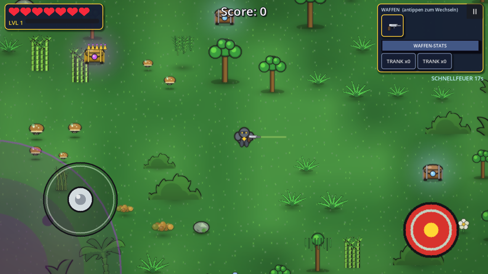
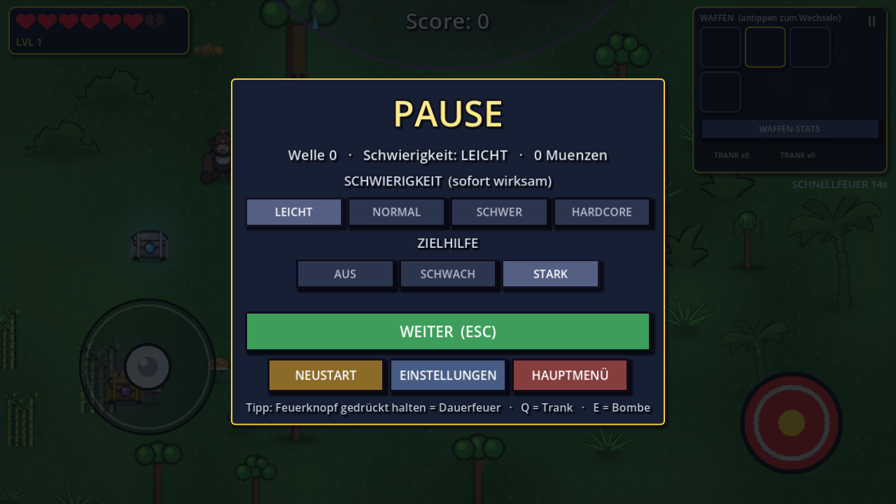
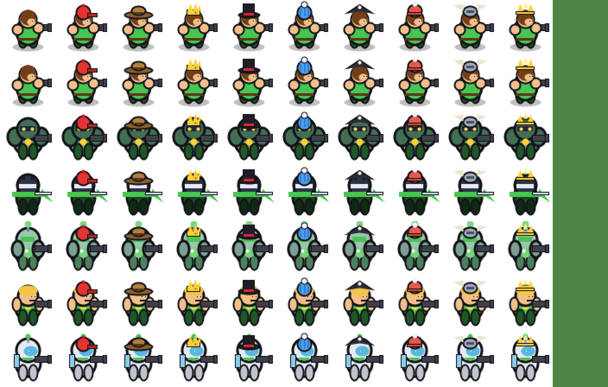

<div align="center">

# Comic Shooter

**Top-down shooter im Comic-Stil — vier Welten, Wellen, Bosse und LAN-Koop für bis zu 4 Spieler.**

[](https://godotengine.org)
[](https://github.com)
[](LICENSE)

[**Download**](../../releases/latest) · [Steuerung](#-steuerung) · [Selbst bauen](#-selbst-bauen) · [Screenshots](#-screenshots)

</div>


## Über das Spiel

Ein runderbasierter Arena-Shooter: du kämpfst dich durch Wellen von Gegnern, sammelst
Gold und rüstest dich zwischen den Wellen im Shop auf. Alle fünf Wellen wartet ein
Mini-Boss mit eigener Fähigkeit, nach zehn ein Riesenboss.

Vier Schauplätze mit eigenen Gegnern, Farben und Bodenbeschaffenheiten:

| Welt | Besonderheit |
|---|---|
| **Erde** | Wiese, Wüste, Eis und Lava in einem durchlaufenden Run |
| **Mars** | Rutschiger Sand, Drift-Physik, Rover und Mars-Männchen |
| **Dschungel** | Dichte Vegetation, Robo-Affen, Sporenblumen |
| **Elektro-Welt** | Stahl und Strom, Teslaspulen, Kettenblitze |

## Features

- **6 Skins × 10 Hüte × 10 Farben** — alle Kombinationen frei spielbar
- **LAN-Koop für 4 Spieler** (ENet): Host ist autoritativ, Clients sehen dieselbe Welt,
  Downed-/Revive-System, Zuschauermodus bei endgültigem Tod
- **Bosse mit Phasen** — jeder Mini-Boss hat eine eigene Fähigkeit und eine
  Überladungsphase ab 35 % HP
- **Shop** zwischen den Wellen: Waffen, Upgrades, Tränke, Bomben
- **Wellen-Modus** — die nächste Welle startet, sobald die aktuelle geräumt ist
- Prozedural erzeugte Grafik und Musik (keine externen Assets nötig)

## Download

Fertige Builds liegen unter [**Releases**](../../releases/latest):

- `ComicShooter.apk` — Android 7.0+ (arm64)
- `ComicShooter.exe` — Windows 10/11 (64-bit)

**Android:** APK installieren, „Unbekannte Quellen" erlauben.
**Windows:** EXE starten, keine Installation nötig.

## Steuerung

| Aktion | Tastatur / Maus | Gamepad |
|---|---|---|
| Bewegen | `WASD` / Pfeiltasten | linker Stick |
| Zielen | Mauszeiger | rechter Stick |
| Schießen | linke Maustaste halten | RT |
| Waffe wechseln | `1`–`6` oder HUD-Slot antippen | Schultertasten |
| Trank / Bombe | `Q` / `E` | LB / RB |
| Pause | `ESC` | Start |

## Selbst bauen

### Voraussetzungen

1. **Godot 4.7.2** (Standard, nicht .NET) — [godotengine.org/download](https://godotengine.org/download)
2. **Export-Templates 4.7.2** — in Godot: *Editor → Manage Export Templates → Download*
3. Nur für Android zusätzlich:
   - **JDK 17+**
   - **Android SDK** (Build-Tools, Platform 34+), Pfade in den Editor-Einstellungen setzen
   - Debug-Keystore (liegt bei den meisten Setups bereits unter `~/.android/debug.keystore`)

### Windows-EXE

```bat
export_exe.bat "C:\Pfad\zu\Godot_v4.7.2-stable_win64.exe"
```

Oder in Godot: *Projekt → Exportieren → Windows Desktop → Export Projekt*.
Ergebnis: `ComicShooter.exe` neben dem `project`-Ordner.

### Android-APK

```bat
export_apk.bat "C:\Pfad\zu\Godot.exe"
```

Oder *Projekt → Exportieren → Android → Export Projekt*.

## Projektstruktur

```
project/
├── assets/              Texturen, Sounds
├── scenes/              Main, Player, Monster, Projectile, Chest, Item
├── scripts/
│   ├── game_manager.gd      Spielzustand, Wellen, Shop, Boss-Buchhaltung
│   ├── player_controller.gd Bewegung, Waffen, Downed/Revive
│   ├── monster_ai.gd        Gegner-KI, Mini-Bosse, Fähigkeiten
│   ├── map_generator.gd     Kartenaufbau, Biome, Boden, Deko
│   ├── texture_manager.gd   prozedurale Grafiken
│   ├── sound_manager.gd     prozedurale Musik und Effekte
│   ├── net_manager.gd       LAN-Koop (ENet)
│   └── ui_manager.gd        HUD, Menüs, Shop, Debug-Fenster
├── shaders/             Postprocessing
└── export_presets.cfg   Presets für Android und Windows
```

## Debug-Fenster

`F9` öffnet im Spiel ein Entwicklerfenster:

- **Charakter** — Farbe, Skin und Hut durchschalten, Vorschau live;
  „Alle Kombinationen" zeigt alle 60 Varianten als klickbares Raster
- **Welt** — direkt in eine andere Karte springen oder die aktuelle neu auswürfeln
- **Alles freischalten** — Gold, Karten, Skins, Hüte, Jahreszeiten
- **Live-Werte** — FPS, Gegnerzahl, Welle, HP, Score

## Screenshots

| | |
|---|---|
|  |  |
|  |  |

## Mitwirken

Issues und Pull Requests sind willkommen. Für Änderungen am Gameplay bitte vorher
ein Issue aufmachen — die Balance hängt an vielen Stellen zusammen.

## Credits

- Engine: [Godot Engine](https://godotengine.org) (MIT)
- Palmen- und Busch-Texturen: [Kenney](https://kenney.nl) — CC0
- Alle übrigen Grafiken, Musik und Sounds werden zur Laufzeit prozedural erzeugt

Details in [CREDITS.md](CREDITS.md).

## Lizenz

Quellcode unter [MIT](LICENSE). Die Kenney-Assets stehen unter CC0.
