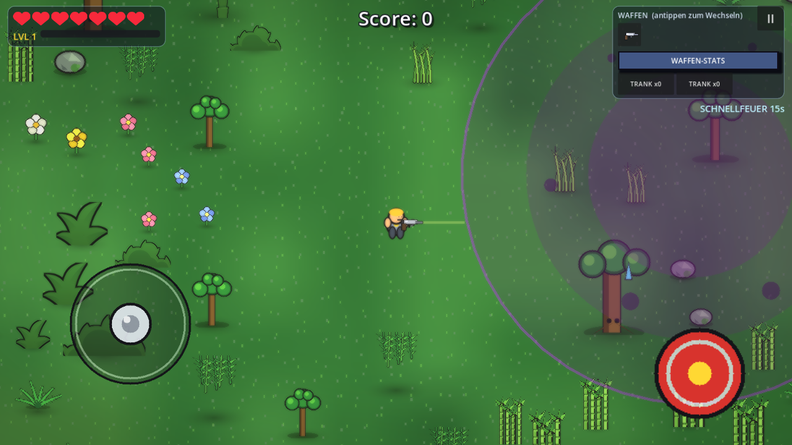
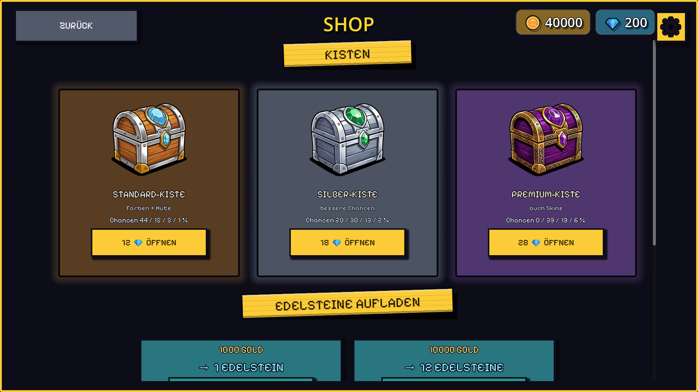
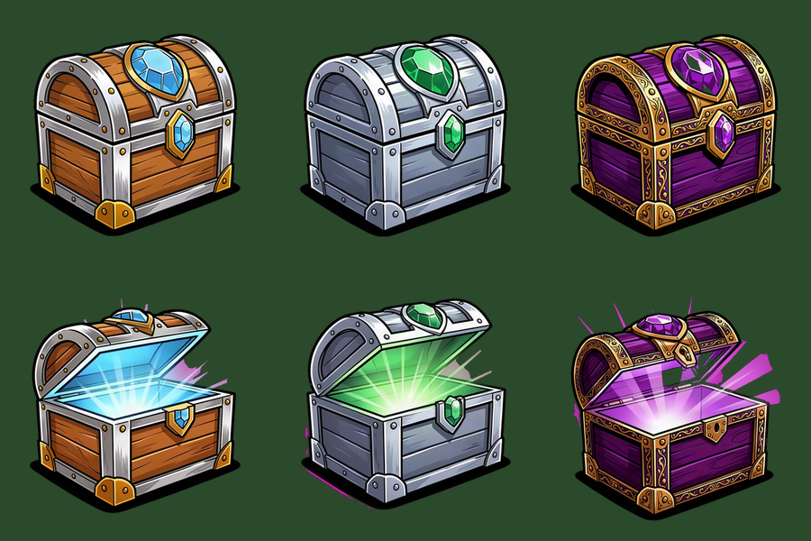

# Comic Shooter

Top-down Comic-Shooter mit vier Welten, Wellen-Modus, Koop über LAN und einem
Kosmetik-Shop mit Edelsteinen und Lootboxen.



## Features

- **Vier Welten** — Erde, Mars, Dschungel, Elektro, jede mit eigener Karte,
  eigener Gegnerliste und eigenem Boss
- **Wellen-Modus** — Mini-Boss alle 5 Wellen, Biome-Boss alle 10
- **Koop über LAN/WLAN** — Host simuliert die Welt, Client schickt Eingaben
- **Kosmetik-Shop** — Farben, Hüte, Skins; Kisten mit 12/18/28 Edelsteinen
- **Lootbox mit Laufband** — CS:GO-artige Öffnung, Seltenheitsstufen mit
  Leucht-Effekten, Nieten (Gold/Edelsteine) als Trostpreis
- **Sofortkäufe** — Schnellfeuer, Tränke, Bomben für den nächsten Run
- **Debug-Modus** — 7× auf die Versionszeile tippen

## Shop




| Kiste | Preis | Inhalt |
|---|---|---|
| Standard | 12 💎 | Farben, Hüte |
| Silber | 18 💎 | bessere Chancen, keine Skins |
| Premium | 28 💎 | zusätzlich Skins, nie gewöhnlich |

Alle Kisten liegen bei rund 35–40 % „nichts Sinnvolles" (Niete, Gold oder
Edelsteine als Trostpreis) — gemessen über 8.000 Züge je Kiste.

## Steuerung

| Taste | Aktion |
|---|---|
| WASD / Pfeile | Bewegen |
| Maus / rechter Stick | Zielen |
| Linke Maustaste | Schießen (halten = Dauerfeuer) |
| Q / E | Trank / Bombe |
| ESC | Pause |
| F9 | Debug-Fenster (Desktop) |

Auf Android: virtueller Stick links, Feuerknopf rechts, Utility-Knöpfe unten.

## Selbst bauen

Voraussetzung: **Godot 4.7** (Standard-Build, kein Mono).

```bash
# Windows-EXE
godot --headless --path project --export-release "Windows Desktop" build/ComicShooter.exe

# Android-APK (Debug-Keystore)
godot --headless --path project --export-debug "Android" build/ComicShooter.apk
```

Oder die mitgelieferten Skripte:

- `export_exe.bat` — baut die Windows-EXE nach `build/`
- `export_apk.bat` — baut die APK nach `build/`

Die Export-Presets liegen in `project/export_presets.cfg`. Für Android wird
ein installiertes Android-SDK (Platform 36, Build-Tools 36) und ein Debug-Keystore
in `%USERPROFILE%\.android\debug.keystore` benötigt.

## Projektstruktur

```
project/
  scenes/        Szenen (Player, Monster, Chest, …)
  scripts/       Gameplay, UI, Map-Generierung, Loot
  assets/        Kisten-Grafiken, Schriften, Sounds
  export_presets.cfg
screenshots/     Bilder für diese README
```

## Lizenz

Code und Grafiken: MIT, siehe [LICENSE](LICENSE).
Schrift „Pixelify Sans" von Stefie Justprince, SIL Open Font License 1.1.
