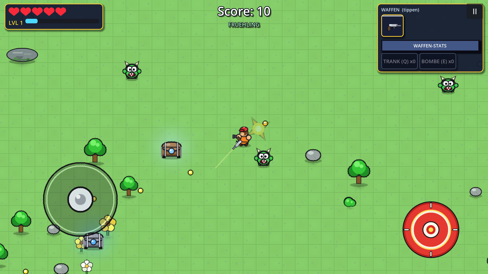
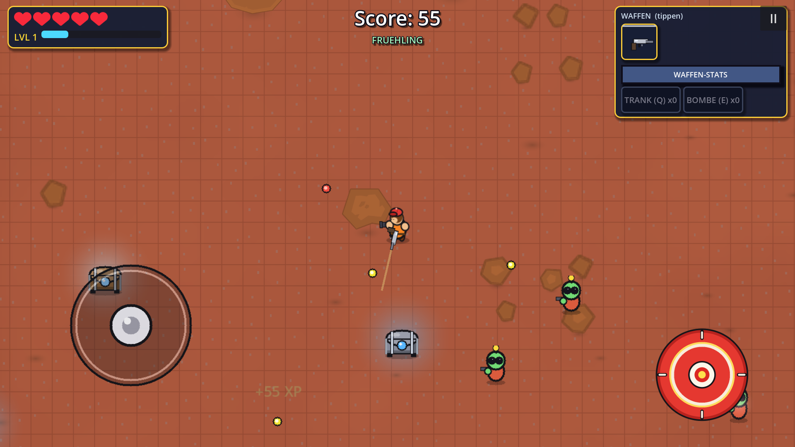
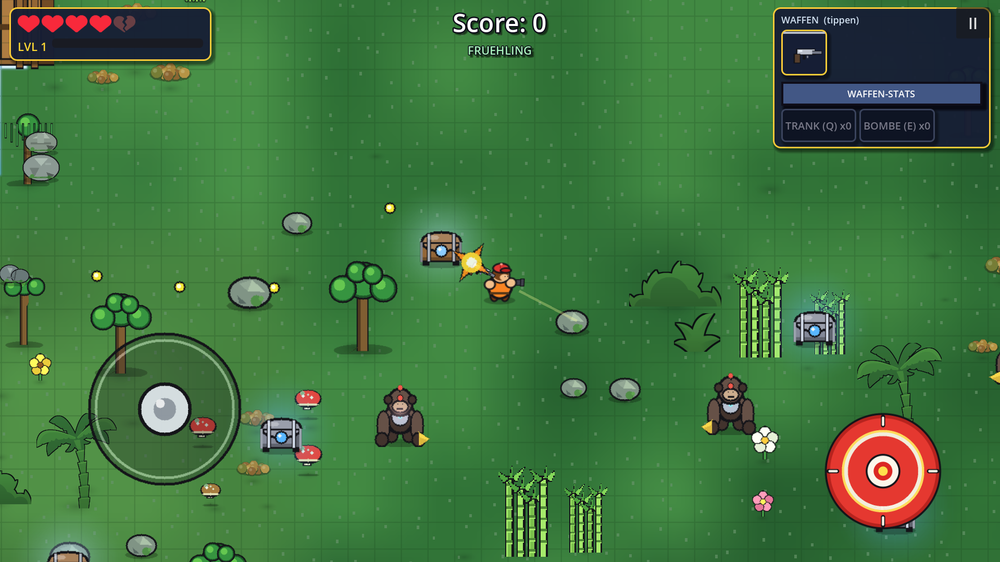
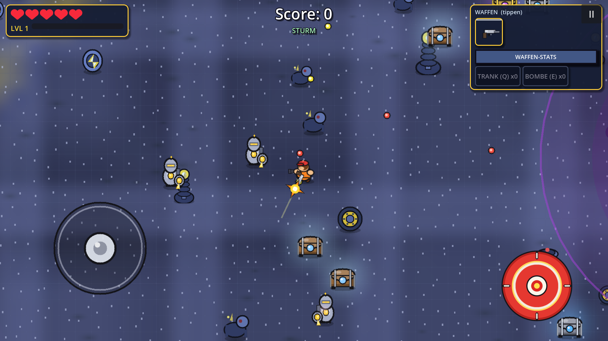
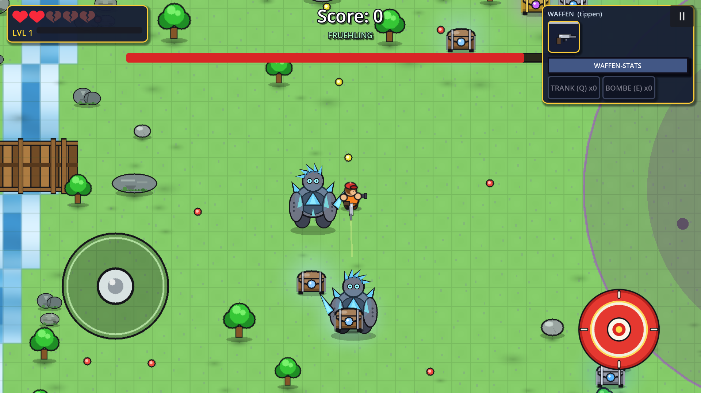
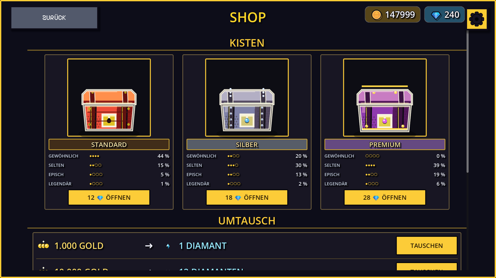
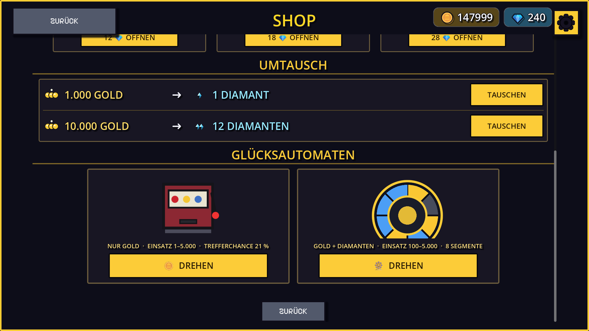
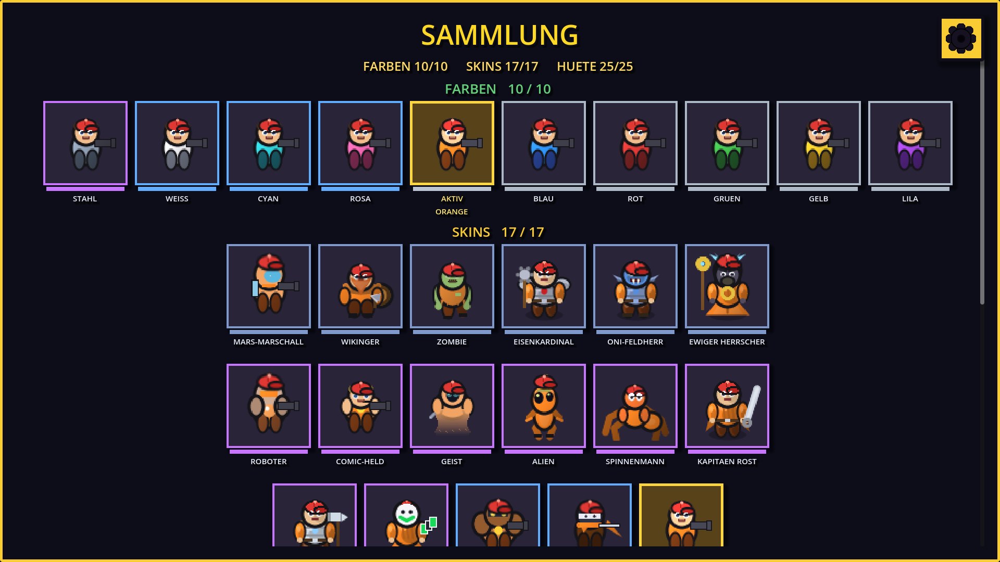
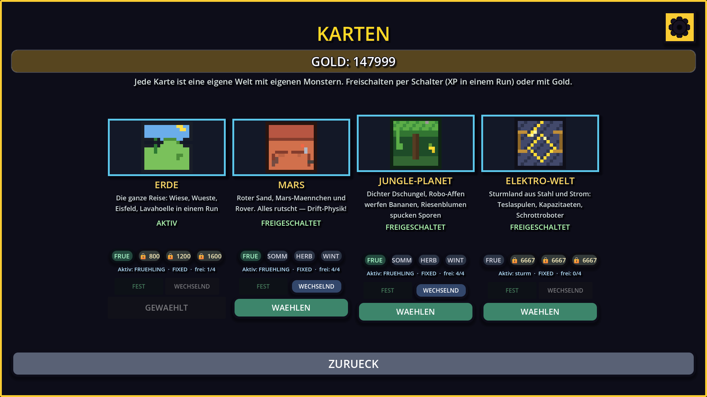
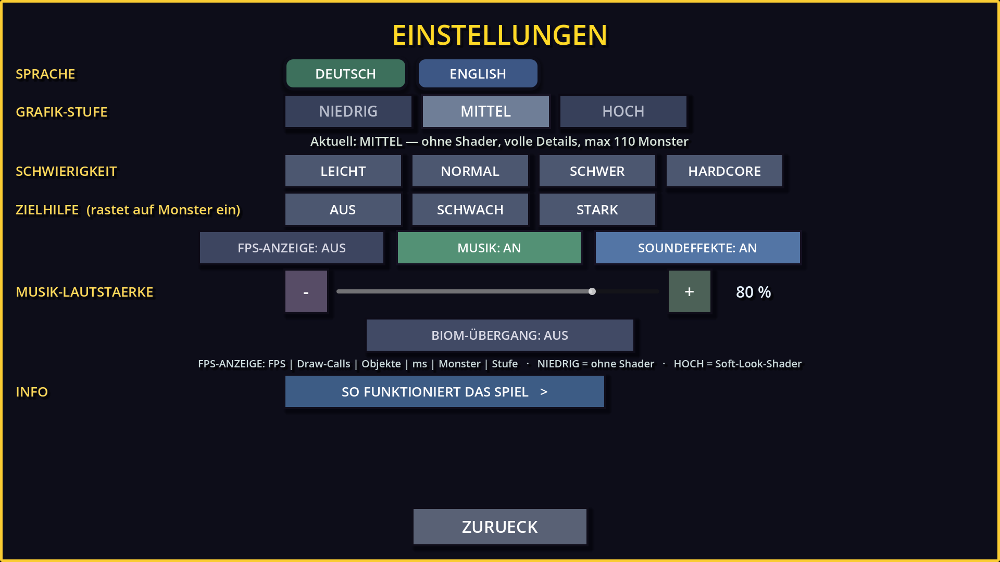

# Comic Shooter

Top-down-Comic-Shooter für Desktop (Windows) und Android. Vier Welten, drei
Spielmodi, Bosse, LAN-Koop und ein Shop mit Kisten und Glücksautomaten.
Godot 4.7, GDScript, Mobile-first mit Touch-Steuerung und virtuellen Sticks.

**Aktuelle Version: 1.58**


## Spielmodi

| Modus | Ablauf |
| --- | --- |
| **Endlos** | Sägezahn-Wellen: Anlauf, Peak, Erholung. Kein Ende, Ziel ist die Bestzeit. |
| **Wellen + Shop** | Welle räumen, im Shop aufrüsten, nächste Welle. Alle 5 Wellen ein Boss. |
| **Runden** | Kurze, feste Runden mit Gruppen und Mini-Bossen, Erholungsfenster dazwischen. |

Vier Schwierigkeitsstufen: Leicht, Normal, Schwer, Hardcore. Die Balance läuft
über **Druck** (Gegner-HP pro Sekunde gegen den Spieler-DPS), nicht über starre
HP-Multiplikatoren — dadurch bleibt das Tempo in jeder Stufe spielbar.

## Die vier Welten

Jede Welt hat eine eigene prozedural erzeugte Karte, eigene Gegner und einen
eigenen Boss.

| Erde | Mars |
| --- | --- |
|  |  |
| **Dschungel** | **Elektro** |
|  |  |

## Bosse

Jede Welt hat einen eigenen Boss mit zwei Phasen und Telegraph vor dem Angriff.
Auf der Karte gibt es zusätzlich Mini-Bosse.



## Shop und Kisten

Kisten kosten 12, 18 oder 28 Edelsteine. Edelsteine gibt es im Umtausch für
Gold (1.000 Gold = 1 💎, 10.000 Gold = 12 💎).



| Kiste | Preis | Inhalt |
| --- | --- | --- |
| Standard | 12 💎 | Farben, Hüte |
| Silber | 18 💎 | bessere Chancen, keine Skins |
| Premium | 28 💎 | zusätzlich Skins, nie gewöhnlich |

Rund 35–40 % der Kisten bringen keinen Skin, sondern Gold oder Edelsteine als
Trostpreis.

## Glücksautomaten

Einarmiger Bandit im Shop — **nur Gold**, keine Edelsteine, keine Items.
Drei Walzenbänder, eine Gewinnlinie, Einsatz 50/100/250. Die Walzen stoppen
versetzt, bei zwei gleichen Symbolen läuft die dritte länger (Anticipation).



Gemessen über 200.000 Spins: **RTP 90,1 %**, Trefferquote 10,3 %.

## Sammlung und Karten

Skins, Hüte und Farben sind rein kosmetisch — die Balance bleibt unberührt.

| Sammlung | Kartenauswahl |
| --- | --- |
|  |  |

## Einstellungen

Musik und Soundeffekte getrennt schaltbar, Grafikqualität, Aim-Assist,
Schwierigkeit.



## Steuerung

| Taste | Aktion |
| --- | --- |
| WASD / Pfeile | Bewegen |
| Maus | Zielen |
| Linke Maustaste | Schießen (halten = Dauerfeuer) |
| Q / E | Trank / Bombe |
| ESC | Pause |
| F9 | Debug-Fenster (Desktop) |

Auf Android: virtueller Stick links, Feuerknopf rechts, Utility-Knöpfe unten.

**Debug-Modus:** 7× auf die Versionszeile auf dem Startbildschirm tippen.
Darin: Weltwechsel, Monster-Auswahl, Boss und Mini-Boss je Karte,
Unverwundbarkeit, alles freischalten.

## Selbst bauen

Voraussetzung: **Godot 4.7** (Standard-Build, kein Mono).

```
# Windows-EXE
godot --headless --path project --export-release "Windows Desktop" build/ComicShooter.exe

# Android-APK (Debug-Keystore)
godot --headless --path project --export-debug "Android" build/ComicShooter.apk
```

Oder die mitgelieferten Skripte `export_exe.bat` und `export_apk.bat`.
Für Android braucht es SDK Platform 36 und einen Debug-Keystore unter
`%USERPROFILE%\.android\debug.keystore`.

## Projektstruktur

```
project/
  scenes/     Szenen (Spieler, Monster, Kisten, UI)
  scripts/    Gameplay, Balance, UI, Karten-Generierung, Loot
  assets/     Grafiken, Schrift, Sounds
screenshots/  Bilder für diese README
```

## Lizenz

Code und Grafiken: MIT, siehe [LICENSE](LICENSE).
Schrift „Pixelify Sans" von Stefie Justprince, SIL Open Font License 1.1.
